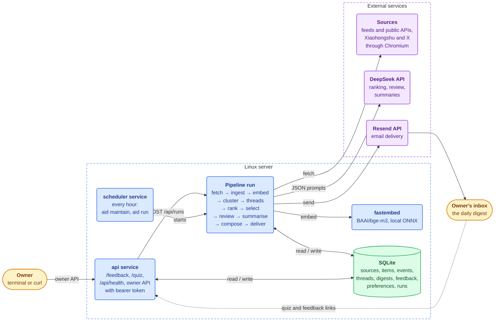
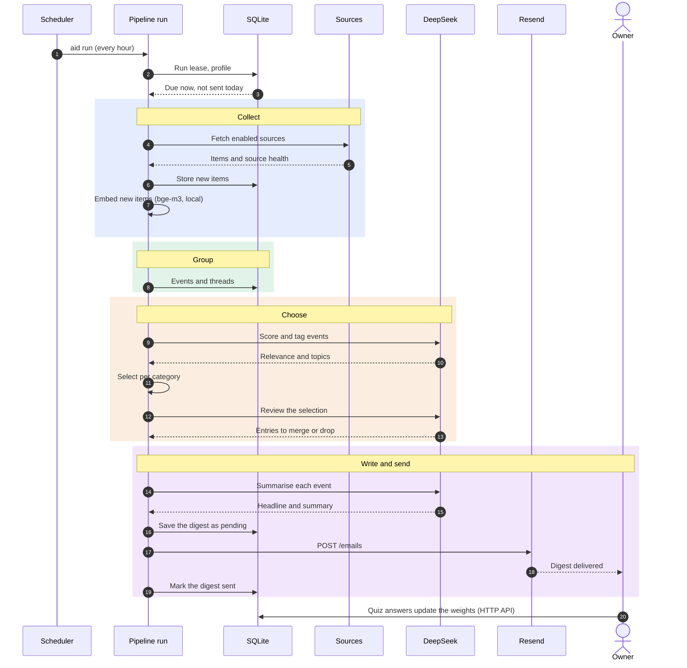
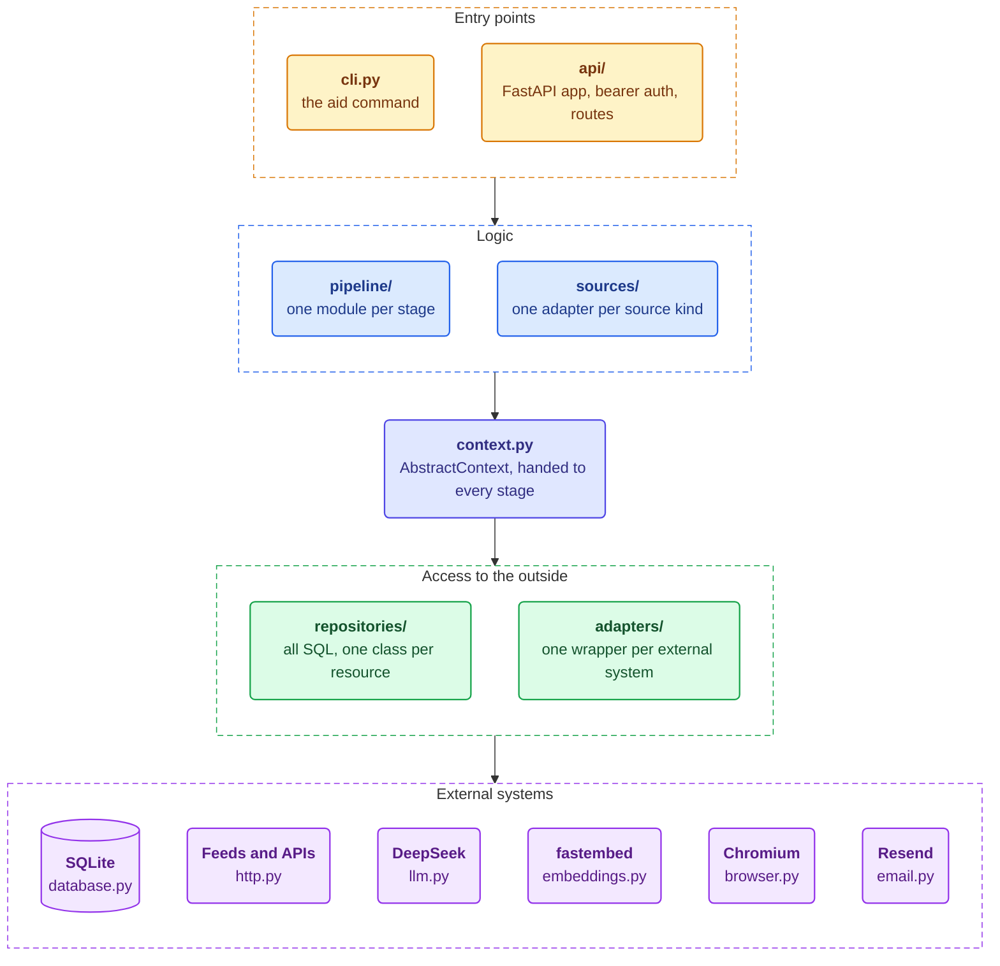

# AI Infra Daily

AI Infra Daily is a personal, single-user service that emails one digest a day about AI
infrastructure. It reads mainstream outlets and vendor blogs for the events, and
individual voices for the interpretation: bloggers, Xiaohongshu and X accounts, Bluesky,
YouTube, Hacker News comments and Reddit posts. Items are deduplicated, clustered into
events, linked into multi-day threads, ranked against the owner's interests, summarised
in the language of the source (English or Chinese) and composed into one email grouped
by category.

One or two questions at the foot of the email tune the next day's ranking. Each link
opens a confirmation page, and the answer applies when the owner confirms.

This is the Python 3.14 rewrite of a Cloudflare Workers prototype. It runs on one Linux
server. The full scope is in [`docs/requirements.md`](docs/requirements.md), and setup
and operations are in [`docs/deployment.md`](docs/deployment.md).

## Contents

- [Architecture](#architecture)
- [Services and libraries used](#services-and-libraries-used)
- [Project structure](#project-structure)
- [How it works](#how-it-works)
- [Local development](#local-development)
- [Configuration](#configuration)
- [Commands](#commands)
- [Deployment](#deployment)
- [Data model](#data-model)
- [Content sources](#content-sources)
- [Limitations](#limitations)
- [Documentation](#documentation)

## Architecture

### Overall system



Blue boxes run on the server and purple boxes are external services. The `scheduler`
and `api` services are two Docker Compose containers of one image. They share the SQLite
file, the embedding model cache and the dry-run previews through the `./data` directory.

A pipeline run is started by the scheduler every hour or by `POST /api/runs`. A lease in
the database lets only one run work at a time. The dotted line is the feedback loop:
the links in the email open the API, and what the owner confirms there changes the
weights that the next run ranks with.

### Daily run sequence



The coloured bands are the four groups of stages. The scheduler starts `aid run` at the
top of every hour. The run stops at once unless the owner's delivery hour has come and
no digest went out that day, so one digest is sent per local day. The digest is saved
before it is sent, so a failed delivery is retried the next hour with the same digest
and without another round of model calls.

### Code layers



Dependencies point one way, from the top of the diagram to the bottom. The file under
each external system is the adapter in `app/adapters/` that wraps it. `settings`,
`logging`, `result` and `vectors` are leaves that any module may import, and `models`
is pure data.

`adapters` wrap every third party and `repositories` own the SQL. `context` bundles
them into one object. `sources` and `pipeline` contain the logic and reach every adapter
and repository through `AbstractContext`, importing only types and error values from
those packages. `cli` and `api` are the entry points that build the context.

Expected failures are returned as values (`OnSuccess[T]`), never raised.

## Services and libraries used

| Service or library | Role |
| --- | --- |
| Docker Compose | Runs the `api` and `scheduler` services from one image on the server |
| SQLite (aiosqlite) | All state: sources, items with their embedding vectors, events, threads, digests, feedback, preferences and run history |
| DeepSeek API (openai client) | Scores and tags events, reviews the selection and writes the summaries. Every reply is JSON and is validated before use |
| fastembed | Runs the `BAAI/bge-m3` embedding model on the local CPU (ONNX) for deduplication, clustering and threads |
| httpx, feedparser | Fetch and parse feeds and public APIs |
| Playwright Chromium | Reads Xiaohongshu and X with the owner's logged-in cookie |
| Resend API | Delivers the email |
| FastAPI, uvicorn | The HTTP API: confirmation pages for the email links, health and the owner API |
| Jinja2 | The email template |
| Pydantic | Frozen models for every domain object and for the model replies |
| uv, ruff, mypy | Dependency management, formatting, linting and strict type checking |

## Project structure

```
/
├── app/
│   ├── cli.py                # The `aid` command
│   ├── api/                  # FastAPI app, bearer auth, routes
│   ├── pipeline/             # One module per stage, plus scoring and feedback
│   │   ├── run.py            # Runs the stages in order, holds the run lease
│   │   ├── ingest.py, embed.py, cluster.py, threads.py
│   │   ├── rank.py, recommend.py, select.py, edit.py
│   │   ├── summarise.py, compose.py, quiz.py, links.py
│   │   ├── feedback.py, feedback_token.py, schedule.py
│   │   └── maintain.py, preview.py
│   ├── sources/              # One adapter per source kind, fetch_all, seeds, registry
│   ├── context.py            # AbstractContext, the production Context and default()
│   ├── repositories/         # One class per stored resource; all SQL lives here
│   ├── adapters/             # http, llm, embeddings, browser, email, clock, ids, database
│   ├── models.py             # Frozen Pydantic models for every domain object
│   ├── vectors.py            # The embedding vector type and its arithmetic
│   ├── result.py             # ServiceError base, OnSuccess[T], is_error / is_success
│   ├── logging.py            # JSON logging with scoped fields (run_id, source_id)
│   └── settings.py           # Flat configuration read from the environment at import time
├── migrations/               # Numbered SQL files applied by `aid migrate`
├── templates/                # The Jinja template of the email
├── deploy/                   # Dockerfile, scheduler script, optional systemd units, Caddyfile
├── compose.yaml              # The api and scheduler services
├── docs/                     # Requirements, deployment, seeded sources, cookie notes
└── data/                     # SQLite database, model cache, dry-run previews (git-ignored)
```

## How it works

### Owner flow

1. Run `aid migrate` and `aid seed` once. The database now holds 51 default sources.
2. Set the recipient, the delivery hour and the topics with `aid prefs` or
   `PUT /api/preferences`.
3. Every hour the scheduler starts a run. At the delivery hour the run fetches the
   sources, groups the items into events, ranks and selects them, writes the summaries
   and sends one email grouped by category.
4. Answer the one or two questions at the foot of the email. Each link opens a
   confirmation page, and the answer changes the next day's ranking when confirmed.
5. Run `aid run --force --dry-run` at any time to build a digest without sending it.
   The HTML is written to `data/digest-<date>.html`.

### What a run does

| Stage | Module | What it does |
| --- | --- | --- |
| fetch | `app/sources/fetch_all.py` | Reads every enabled source, 8 at a time. A source that fails is skipped and listed in the footer of the email |
| ingest | `app/pipeline/ingest.py` | Stores the items not seen before. An item's id is the hash of its canonical URL, so the same page is stored once |
| embed | `app/pipeline/embed.py` | Embeds each new item with `BAAI/bge-m3` on the local CPU |
| cluster | `app/pipeline/cluster.py` | Groups the items of the last 72 hours into events by embedding similarity. An event takes new items for 36 hours |
| threads | `app/pipeline/threads.py` | Links an event to an earlier one about the same story, which gives the "Day N of this story" badge. Pinned threads match on keywords |
| rank | `app/pipeline/rank.py`, `recommend.py` | The model scores each event against the interest profile and tags its topics. The score is then weighted by what the owner has taught the service |
| select | `app/pipeline/select.py` | Takes the best events of each category up to the budget and keeps a share for individual voices |
| review | `app/pipeline/edit.py` | One model call merges entries that report the same story and drops stories that repeat the last 7 days |
| summarise | `app/pipeline/summarise.py` | Writes a headline and a summary for each event in the language of its sources |
| compose | `app/pipeline/compose.py` | Renders the email from `templates/digest.html.j2` with the questions and the source footer |
| deliver | `app/pipeline/run.py` | Stores the digest, then sends it through Resend. A digest that did not go out is sent again the next hour, up to 3 failed attempts a day |

### Ranking and learning

`app/pipeline/recommend.py` holds the scoring as pure functions. The model scores each
event against the interest profile and tags it with topics from a fixed list. The
recommendation score multiplies that relevance by the strongest source weight, the
owner's weight for the topics, a coverage boost (several independent sources), a
freshness decay and a penalty for events with next to no text. Repeats of a story
already ranked higher are held back.

Topic weights start neutral. They move with the per-event feedback links and with the
one or two multiple-choice questions at the foot of every email
(`app/pipeline/quiz.py`). A link opens a confirmation page, and the weights change when
the owner confirms. `aid prefs show` prints them.

### Selection and writing

The email is organised by category, taken from each event's main topic. Every category
gets its best events up to a budget of 10, 15 or 20 by digest style, so no single
category fills the digest. By default an event is a title and a short summary
(`DIGEST_COMPACT` in `app/settings.py`).

Before the email is composed, the review stage merges entries that report the same
story and drops stories that only repeat the last few days. Headlines and summaries
follow the house style in `app/pipeline/_style.py`, taken from the owner's humanizer
guide: plain sentence-case headlines, summaries that name who did what, and no dashes
or stock phrasing.

### Running unattended

- A source that fails is skipped and reported in the footer of the email. The run
  carries on with the others.
- A run that is killed leaves a lease that expires after 90 minutes, and the next run
  marks it as abandoned.
- A digest that did not go out is sent again the next hour. After 3 failed attempts in
  one local day the service waits for the next day.
- `aid maintain` runs every hour. It removes the text and vectors of items older than
  30 days and keeps one database backup per day for 7 days.
- `GET /api/health` and `aid runs list` show the last run, its last stage and its
  error.

## Local development

### Prerequisites

| Requirement | Version or size | Notes |
| --- | --- | --- |
| Operating system | Linux | The commands in this file were run on Ubuntu under WSL2 |
| Python | 3.14 | Pinned in `.python-version`; `uv` installs it |
| uv | 0.13.7 | The version in `deploy/Dockerfile` and the one used here |
| Free RAM | 4 GB | The `BAAI/bge-m3` embedding model uses about 3 GB while a run embeds new items |
| Disk | 6 GB for the Docker deployment | Image 2.8 GB, embedding model 2.2 GB |
| Docker with Compose v2 | any current release | Server deployment only |
| DeepSeek API key | | Ranking and summaries. Without it no digest can be written |
| Resend API key | | Sending the email. A dry run does not need it |
| Chromium | installed by Playwright | Only for the Xiaohongshu and X sources: `uv run playwright install chromium` |

### Setup

```bash
uv sync --all-groups
cp .env.example .env
export UV_ENV_FILE=.env
uv run aid migrate
uv run aid seed
uv run aid run --force --dry-run
```

Set `DEEPSEEK_API_KEY` in `.env` before the last command. `aid migrate` prints
`applied 7 migration(s)` and `aid seed` prints `seeded 51 new source(s)`. The dry run
fetches every source, builds the digest and writes it to `data/digest-<date>.html`
without sending anything.

The first run downloads the embedding model (2.2 GB) into the fastembed cache. A full
run normally takes 15 to 20 minutes.

`uv` does not read `.env` by itself, and the settings module stops at import time when a
variable is missing. `UV_ENV_FILE=.env` makes every `uv run` in that shell load the
file. `uv run --env-file .env aid ...` does the same for one command.

### Checks

```bash
uv run ruff format --check && uv run ruff check && uv run mypy
```

CI runs the same three commands on every push to `main` and on every pull request
(`.github/workflows/ci.yml`). `mypy` runs in strict mode.

## Configuration

All configuration is environment variables, read once at import time by
`app/settings.py`. `.env.example` lists every variable. A variable without a default
must be present, even when its value is empty.

| Variable | Meaning |
| --- | --- |
| `DATABASE_PATH` | SQLite file. Backups go to `backups/` next to it |
| `DEEPSEEK_API_KEY`, `DEEPSEEK_BASE_URL`, `LLM_MODEL` | The OpenAI-compatible model API used for ranking, the editor pass and summaries |
| `EMBEDDING_MODEL` | Local embedding model served by fastembed (ONNX, CPU). The thresholds in `app/settings.py` are calibrated for `BAAI/bge-m3` |
| `OWNER_EMAIL`, `TIMEZONE`, `DELIVERY_HOUR`, `DIGEST_STYLE` | Initial profile: recipient, timezone, local hour to send at, and `brief`, `balanced` or `deep`. After the first change made with `aid prefs` or the API, the profile lives in the database |
| `RESEND_API_KEY`, `EMAIL_FROM` | How the email is sent. Quote `EMAIL_FROM` when it contains spaces |
| `PUBLIC_BASE_URL` | Public address of the API. The links in the email point here |
| `OWNER_TOKEN` | Bearer token for the owner API. Empty switches the owner API off |
| `FEEDBACK_SECRET` | Signs the links in the email. Empty rejects every link |
| `API_HOST`, `API_PORT` | Where `aid serve` listens |
| `AID_UID`, `API_PUBLISH` | Used by `compose.yaml` only: the host user that owns `./data`, and the host address Docker publishes the API on |
| `XIAOHONGSHU_COOKIE`, `X_COOKIE` | Logged-in cookie headers. Empty switches that source off. See [`docs/xiaohongshu.md`](docs/xiaohongshu.md) and [`docs/x.md`](docs/x.md) |
| `LOG_LEVEL` | Level of the JSON log lines on stderr |

Generate the two secrets with `openssl rand -hex 32`. Tuning constants that are not
secrets (thresholds, budgets, retention) are plain values in `app/settings.py`.

## Commands

Every command is `uv run aid <command>` locally, or
`docker compose run --rm aid aid <command>` on the server.

```bash
uv run aid run                       # sends only at the delivery hour, once per day
uv run aid run --force               # ignores the delivery hour
uv run aid run --force --dry-run     # full pipeline, HTML written to data/
uv run aid sources list
uv run aid sources disable openai-news
uv run aid prefs set-hour 7
uv run aid runs list
uv run aid serve
```

| Command | What it does |
| --- | --- |
| `migrate` | Creates or upgrades the database |
| `seed` | Inserts the default sources that are missing and brings the others up to date with `app/sources/seeds.py`. It never changes `enabled` or `weight` |
| `run [--force] [--dry-run]` | Runs the whole pipeline. Without `--force` it sends only from the delivery hour on, once per local day |
| `stage fetch\|embed\|cluster\|threads` | Runs one stage, which is the quickest way to see where a run stops |
| `sources list\|enable <id>\|disable <id>\|weight <id> <value>` | Lists or edits sources. A weight is between 0.2 and 2.0 |
| `prefs show` | Prints the profile and the interests, including the learned topic weights |
| `prefs set-email\|set-hour\|set-style\|set-depth <value>` | Edits the profile and the technical depth. The hour is 0 to 23 |
| `prefs add-topic\|remove-topic <value>` | Edits the topics of interest |
| `prefs add-keyword [--exclude]\|remove-keyword <value>` | Edits the keywords to favour or to avoid |
| `prefs follow\|block\|unblock <value>` | Follows an author, or blocks and unblocks a source |
| `digests list` | Recent digests with their delivery status |
| `runs list` | Recent runs with their outcome, last stage and error |
| `threads list\|pin <id>\|unpin <id>` | Lists active threads. New events of a pinned thread are always kept in the digest until the thread has been quiet for 7 days |
| `maintain` | Prunes old data and backs the database up once a day. The scheduler runs it every hour |
| `serve` | Serves the HTTP API on `API_HOST:API_PORT` |

The HTTP API serves the confirmation pages behind the email links (`/feedback`,
`/quiz`), a health endpoint and the owner endpoints under `/api`. `GET /api/health`
needs no token and reports the last run and the last day a digest went out. The owner
endpoints are listed in [`docs/deployment.md`](docs/deployment.md).

## Deployment

```bash
cp .env.example .env
docker compose build
docker compose run --rm aid aid migrate
docker compose run --rm aid aid seed
docker compose run --rm aid aid run --force --dry-run
docker compose up -d
```

Fill in `.env` before the first run. The dry run writes a preview to
`data/digest-<date>.html`, and `docker compose up -d` starts the API and the hourly
scheduler. [`docs/deployment.md`](docs/deployment.md) has the full steps, HTTPS with
Caddy, cookie refresh, updating and troubleshooting.

## Data model

Everything is stored in one SQLite file. The tables are created by the files in
`migrations/`.

| Table | Contents |
| --- | --- |
| `sources` | One row per source: kind, category, language, `enabled`, `weight` and the kind-specific config |
| `source_runs` | One row per fetch attempt per source, for the health footer of the email |
| `items` | Fetched posts and articles, keyed by the hash of the canonical URL. The embedding is stored inline as float32 bytes |
| `events` | Items about the same story, with the model scores cached per event |
| `threads` | Events about the same story across days, with the day count and the pin |
| `digests` | Every digest built: date, subject, HTML, source health and delivery status |
| `digest_events` | Which events and items appeared in which digest, with section, position, score and topics |
| `feedback` | Each feedback link that acted. A link acts once |
| `quiz_answers` | The answers to the questions in the email |
| `preferences` | Two JSON documents, `profile` and `interests` |
| `runs`, `run_lease` | One row per pipeline run with its stage and outcome, and the lease that allows one run at a time |

The two preference documents:

```python
profile = {
    "email": str,
    "timezone": str,
    "delivery_hour": int,  # 0 to 23
    "digest_style": "brief" | "balanced" | "deep",
}
interests = {
    "topics": [str],
    "keywords_include": [str],
    "keywords_exclude": [str],
    "followed_authors": [str],
    "preferred_sources": [str],
    "blocked_sources": [str],
    "technical_depth": "high-level" | "practical" | "deep",
    "topic_weights": {topic: float},  # learned; a missing topic counts as 1.0
}
```

## Content sources

`aid seed` inserts 51 sources from `app/sources/seeds.py`. The list with every feed
address is in [`docs/sources.md`](docs/sources.md).

| Kind | Seeded | How it is read |
| --- | --- | --- |
| `rss` | 31 | RSS and Atom feeds: 10 vendor blogs, 7 media outlets, 6 paper feeds, 8 personal blogs |
| `bluesky` | 9 | Author feeds from the public Bluesky API |
| `hn` | 4 | Hacker News through the Algolia API, with the top comments |
| `youtube` | 3 | The Atom feed of each channel |
| `reddit` | 2 | The public Atom feed of r/MachineLearning and r/LocalLLaMA |
| `xiaohongshu` | 1 | The following feed in a logged-in browser. Off until a cookie is set |
| `x` | 1 | The home timeline in a logged-in browser. Off until a cookie is set |

Add or change a source in `app/sources/seeds.py` and run `aid seed`. Switch one off or
change its weight with `aid sources`.

## Limitations

- One owner. There are no accounts, and the owner API is protected by a single bearer
  token.
- Published directly, the API speaks plain HTTP. Put a reverse proxy in front before
  calling the owner endpoints over a network; `docs/deployment.md` shows one with Caddy.
- Reddit is read from its public Atom feed, so Reddit items carry no scores and no
  comments.
- Xiaohongshu and X are fetched with a logged-in browser session. Both sources are off
  until a cookie is configured, and the cookies expire every few weeks.
- Summaries are written in English or Chinese. Items in any other language are
  summarised in English.
- The chat interface in the requirements (FR7.3) is not implemented. Preferences change
  through the email questions, `aid prefs` and `PUT /api/preferences`.
- The threshold that links an event to an earlier thread (`THREAD_SIMILARITY_THRESHOLD`)
  is provisional. It was set from one day of data.

## Documentation

| File | Contents |
| --- | --- |
| [`docs/requirements.md`](docs/requirements.md) | Functional requirements, quality attributes and the source feasibility table |
| [`docs/deployment.md`](docs/deployment.md) | Server setup with Docker, HTTPS, cookie refresh, updating, the owner API and troubleshooting |
| [`docs/sources.md`](docs/sources.md) | The seeded sources and the live audit of them |
| [`docs/xiaohongshu.md`](docs/xiaohongshu.md), [`docs/x.md`](docs/x.md) | How each platform is read and how to renew its cookie |
