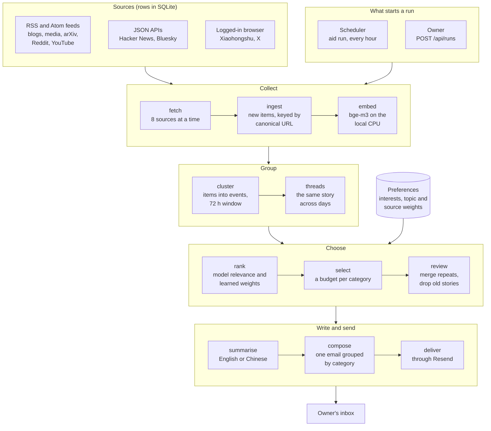
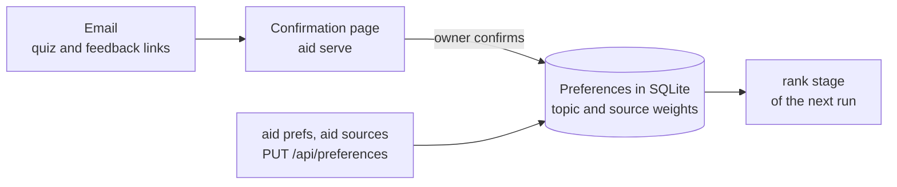
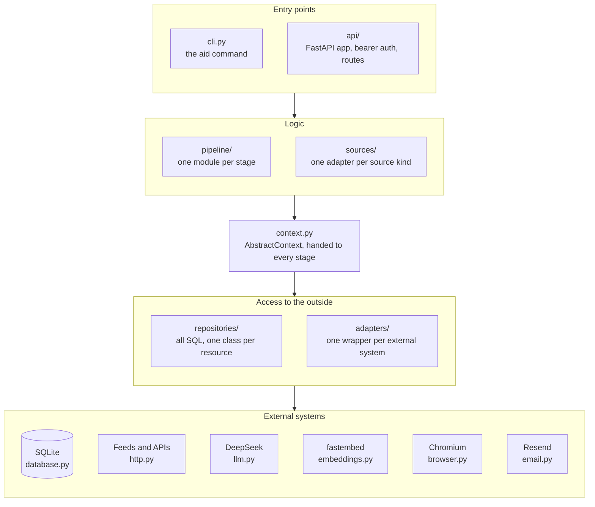

# AI Infra Daily

AI Infra Daily is a personal, single-user service that emails one digest a day about AI
infrastructure. It reads mainstream outlets and vendor blogs for the events, and
individual voices for the interpretation: bloggers, Xiaohongshu and X accounts, Bluesky,
YouTube, Hacker News comments and Reddit posts. Items are deduplicated, clustered into
events, linked into multi-day threads, ranked against the owner's interests, summarised
in the language of the source (English or Chinese) and composed into one email grouped
by category.

One or two questions at the foot of the email tune the next day's ranking. Each link
opens a confirmation page, and the answer applies when the owner confirms.

This is the Python 3.14 rewrite of a Cloudflare Workers prototype. It runs on one Linux
server. The full scope is in [`docs/requirements.md`](docs/requirements.md), and setup
and operations are in [`docs/deployment.md`](docs/deployment.md).

## Contents

- [How it works](#how-it-works)
- [Code structure](#code-structure)
- [Quick start](#quick-start)
- [Requirements](#requirements)
- [Configuration](#configuration)
- [Usage](#usage)
- [Checks](#checks)
- [Project layout](#project-layout)
- [Documentation](#documentation)
- [Limitations](#limitations)

## How it works



A run goes through four groups of stages, top to bottom in the diagram. The scheduler
starts `aid run` at the top of every hour. The run stops at once unless the owner's
delivery hour has come and no digest went out that day, so one digest is sent per local
day. `POST /api/runs` starts the same run on demand.

| Stage | Module | What it does |
| --- | --- | --- |
| fetch | `app/sources/fetch_all.py` | Reads every enabled source, 8 at a time. A source that fails is skipped and listed in the footer of the email |
| ingest | `app/pipeline/ingest.py` | Stores the items not seen before. An item's id is the hash of its canonical URL, so the same page is stored once |
| embed | `app/pipeline/embed.py` | Embeds each new item with `BAAI/bge-m3` on the local CPU |
| cluster | `app/pipeline/cluster.py` | Groups the items of the last 72 hours into events by embedding similarity. An event takes new items for 36 hours |
| threads | `app/pipeline/threads.py` | Links an event to an earlier one about the same story, which gives the "Day N of this story" badge. Pinned threads match on keywords |
| rank | `app/pipeline/rank.py`, `recommend.py` | The model scores each event against the interest profile and tags its topics. The score is then weighted by what the owner has taught the service |
| select | `app/pipeline/select.py` | Takes the best events of each category up to the budget and keeps a share for individual voices |
| review | `app/pipeline/edit.py` | One model call merges entries that report the same story and drops stories that repeat the last 7 days |
| summarise | `app/pipeline/summarise.py` | Writes a headline and a summary for each event in the language of its sources |
| compose | `app/pipeline/compose.py` | Renders the email from `templates/digest.html.j2` with the questions and the source footer |
| deliver | `app/pipeline/run.py` | Stores the digest, then sends it through Resend. A digest that did not go out is sent again the next hour, up to 3 failed attempts a day |

Sources are rows in SQLite with a kind, a category, a weight and an enabled flag. The
owner disables or reweights one with `aid sources` or the API, without a deploy.

### Ranking and learning

`app/pipeline/recommend.py` holds the scoring as pure functions. The model scores each
event against the interest profile and tags it with topics from a fixed list. The
recommendation score multiplies that relevance by the strongest source weight, the
owner's weight for the topics, a coverage boost (several independent sources), a
freshness decay and a penalty for events with next to no text. Repeats of a story
already ranked higher are held back.



Topic weights start neutral. They move with the per-event feedback links and with the
one or two multiple-choice questions at the foot of every email
(`app/pipeline/quiz.py`). A link opens a confirmation page, and the weights change when
the owner confirms. `aid prefs show` prints them.

### Selection and writing

The email is organised by category, taken from each event's main topic. Every category
gets its best events up to a budget of 10, 15 or 20 by digest style, so no single
category fills the digest. By default an event is a title and a short summary
(`DIGEST_COMPACT` in `app/settings.py`).

Before the email is composed, the review stage merges entries that report the same
story and drops stories that only repeat the last few days. Headlines and summaries
follow the house style in `app/pipeline/_style.py`, taken from the owner's humanizer
guide: plain sentence-case headlines, summaries that name who did what, and no dashes
or stock phrasing.

## Code structure



Dependencies point one way, from the top of the diagram to the bottom. The file under
each external system is the adapter in `app/adapters/` that wraps it. `settings`,
`logging`, `result` and `vectors` are leaves that any module may import, and `models`
is pure data.

`adapters` wrap every third party and `repositories` own the SQL. `context` bundles
them into one object. `sources` and `pipeline` contain the logic and reach every adapter
and repository through `AbstractContext`, importing only types and error values from
those packages. `cli` and `api` are the entry points that build the context.

Expected failures are returned as values (`OnSuccess[T]`), never raised.

## Quick start

```bash
uv sync --all-groups
cp .env.example .env
export UV_ENV_FILE=.env
uv run aid migrate
uv run aid seed
uv run aid run --force --dry-run
```

Set `DEEPSEEK_API_KEY` in `.env` before the last command. `aid migrate` prints
`applied 7 migration(s)` and `aid seed` prints `seeded 51 new source(s)`. The dry run
fetches every source, builds the digest and writes it to `data/digest-<date>.html`
without sending anything.

The first run downloads the embedding model (2.2 GB) into the fastembed cache. A full
run normally takes 15 to 20 minutes.

`uv` does not read `.env` by itself, and the settings module stops at import time when a
variable is missing. `UV_ENV_FILE=.env` makes every `uv run` in that shell load the
file. `uv run --env-file .env aid ...` does the same for one command.

To run it as a service, follow [`docs/deployment.md`](docs/deployment.md).

## Requirements

| Requirement | Version or size | Notes |
| --- | --- | --- |
| Operating system | Linux | The commands in this file were run on Ubuntu under WSL2 |
| Python | 3.14 | Pinned in `.python-version`; `uv` installs it |
| uv | 0.13.7 | The version in `deploy/Dockerfile` and the one used here |
| Free RAM | 4 GB | The `BAAI/bge-m3` embedding model uses about 3 GB while a run embeds new items |
| Disk | 6 GB for the Docker deployment | Image 2.8 GB, embedding model 2.2 GB |
| Docker with Compose v2 | any current release | Server deployment only |
| DeepSeek API key | | Ranking and summaries. Without it no digest can be written |
| Resend API key | | Sending the email. A dry run does not need it |
| Chromium | installed by Playwright | Only for the Xiaohongshu and X sources: `uv run playwright install chromium` |

## Configuration

All configuration is environment variables, read once at import time by
`app/settings.py`. `.env.example` lists every variable. A variable without a default
must be present, even when its value is empty.

| Variable | Meaning |
| --- | --- |
| `DATABASE_PATH` | SQLite file. Backups go to `backups/` next to it |
| `DEEPSEEK_API_KEY`, `DEEPSEEK_BASE_URL`, `LLM_MODEL` | The OpenAI-compatible model API used for ranking, the editor pass and summaries |
| `EMBEDDING_MODEL` | Local embedding model served by fastembed (ONNX, CPU). The thresholds in `app/settings.py` are calibrated for `BAAI/bge-m3` |
| `OWNER_EMAIL`, `TIMEZONE`, `DELIVERY_HOUR`, `DIGEST_STYLE` | Initial profile: recipient, timezone, local hour to send at, and `brief`, `balanced` or `deep`. After the first change made with `aid prefs` or the API, the profile lives in the database |
| `RESEND_API_KEY`, `EMAIL_FROM` | How the email is sent. Quote `EMAIL_FROM` when it contains spaces |
| `PUBLIC_BASE_URL` | Public address of the API. The links in the email point here |
| `OWNER_TOKEN` | Bearer token for the owner API. Empty switches the owner API off |
| `FEEDBACK_SECRET` | Signs the links in the email. Empty rejects every link |
| `API_HOST`, `API_PORT` | Where `aid serve` listens |
| `AID_UID`, `API_PUBLISH` | Used by `compose.yaml` only: the host user that owns `./data`, and the host address Docker publishes the API on |
| `XIAOHONGSHU_COOKIE`, `X_COOKIE` | Logged-in cookie headers. Empty switches that source off. See [`docs/xiaohongshu.md`](docs/xiaohongshu.md) and [`docs/x.md`](docs/x.md) |
| `LOG_LEVEL` | Level of the JSON log lines on stderr |

Generate the two secrets with `openssl rand -hex 32`. Tuning constants that are not
secrets (thresholds, budgets, retention) are plain values in `app/settings.py`.

## Usage

Every command is `uv run aid <command>` locally, or
`docker compose run --rm aid aid <command>` on the server.

```bash
uv run aid run                       # sends only at the delivery hour, once per day
uv run aid run --force               # ignores the delivery hour
uv run aid run --force --dry-run     # full pipeline, HTML written to data/
uv run aid sources list
uv run aid sources disable openai-news
uv run aid prefs set-hour 7
uv run aid runs list
uv run aid serve
```

| Command | What it does |
| --- | --- |
| `migrate` | Creates or upgrades the database |
| `seed` | Inserts the default sources that are missing and brings the others up to date with `app/sources/seeds.py`. It never changes `enabled` or `weight` |
| `run [--force] [--dry-run]` | Runs the whole pipeline. Without `--force` it sends only from the delivery hour on, once per local day |
| `stage fetch\|embed\|cluster\|threads` | Runs one stage, which is the quickest way to see where a run stops |
| `sources list\|enable <id>\|disable <id>\|weight <id> <value>` | Lists or edits sources. A weight is between 0.2 and 2.0 |
| `prefs show` | Prints the profile and the interests, including the learned topic weights |
| `prefs set-email\|set-hour\|set-style\|set-depth <value>` | Edits the profile and the technical depth. The hour is 0 to 23 |
| `prefs add-topic\|remove-topic <value>` | Edits the topics of interest |
| `prefs add-keyword [--exclude]\|remove-keyword <value>` | Edits the keywords to favour or to avoid |
| `prefs follow\|block\|unblock <value>` | Follows an author, or blocks and unblocks a source |
| `digests list` | Recent digests with their delivery status |
| `runs list` | Recent runs with their outcome, last stage and error |
| `threads list\|pin <id>\|unpin <id>` | Lists active threads. New events of a pinned thread are always kept in the digest until the thread has been quiet for 7 days |
| `maintain` | Prunes old data and backs the database up once a day. The scheduler runs it every hour |
| `serve` | Serves the HTTP API on `API_HOST:API_PORT` |

The HTTP API serves the confirmation pages behind the email links (`/feedback`,
`/quiz`), a health endpoint and the owner endpoints under `/api`. `GET /api/health`
needs no token and reports the last run and the last day a digest went out. The owner
endpoints are listed in [`docs/deployment.md`](docs/deployment.md).

## Checks

```bash
uv run ruff format --check && uv run ruff check && uv run mypy
```

CI runs the same three commands on every push to `main` and on every pull request
(`.github/workflows/ci.yml`). `mypy` runs in strict mode.

## Project layout

```
app/
  settings.py        flat configuration read from the environment at import time
  logging.py         JSON logging with scoped fields (run_id, source_id)
  result.py          ServiceError base, OnSuccess[T], is_error / is_success
  models.py          frozen Pydantic models for every domain object
  vectors.py         the embedding vector type and its arithmetic
  context.py         AbstractContext, the production Context and default()
  adapters/          http, llm, embeddings, browser, email, clock, ids, database
  repositories/      one class per stored resource; all SQL lives here
  sources/           one adapter per source kind, fetch_all, seeds, registry
  pipeline/          ingest, embed, cluster, threads, rank, recommend, select, edit,
                     summarise, compose, quiz, links, feedback, feedback_token,
                     schedule, run, maintain, preview
  api/               FastAPI app, bearer auth, routes
  cli.py             the `aid` command
migrations/          numbered SQL files applied by `aid migrate`
templates/           the Jinja template of the email
compose.yaml         api and scheduler services
deploy/              Dockerfile, scheduler script, optional systemd units, Caddyfile
docs/                requirements, deployment, seeded sources, per-platform cookie notes
data/                SQLite database, model cache and dry-run previews (git-ignored)
```

## Documentation

| File | Contents |
| --- | --- |
| [`docs/requirements.md`](docs/requirements.md) | Functional requirements, quality attributes and the source feasibility table |
| [`docs/deployment.md`](docs/deployment.md) | Server setup with Docker, HTTPS, cookie refresh, updating, the owner API and troubleshooting |
| [`docs/sources.md`](docs/sources.md) | The seeded sources and the live audit of them |
| [`docs/xiaohongshu.md`](docs/xiaohongshu.md), [`docs/x.md`](docs/x.md) | How each platform is read and how to renew its cookie |

## Limitations

- One owner. There are no accounts, and the owner API is protected by a single bearer
  token.
- Published directly, the API speaks plain HTTP. Put a reverse proxy in front before
  calling the owner endpoints over a network; `docs/deployment.md` shows one with Caddy.
- Reddit is read from its public Atom feed, so Reddit items carry no scores and no
  comments.
- Xiaohongshu and X are fetched with a logged-in browser session. Both sources are off
  until a cookie is configured, and the cookies expire every few weeks.
- Summaries are written in English or Chinese. Items in any other language are
  summarised in English.
- The chat interface in the requirements (FR7.3) is not implemented. Preferences change
  through the email questions, `aid prefs` and `PUT /api/preferences`.
- The threshold that links an event to an earlier thread (`THREAD_SIMILARITY_THRESHOLD`)
  is provisional. It was set from one day of data.
